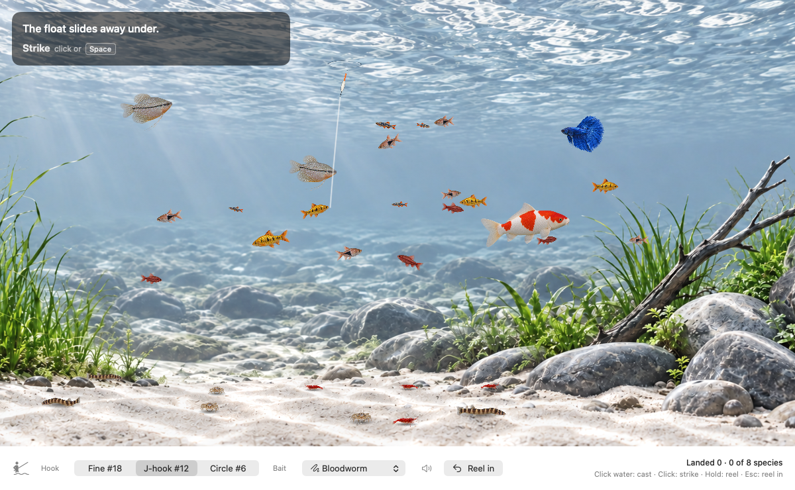

# Stillwater 2.0.1 — Read the float

Released 18 October 2026 · Apple Silicon · macOS 14 or later

Stillwater 2.0.1 reworks the moment a fish takes your bait. The orange halo and the "STRIKE NOW" pill are gone. You now read the bite from the float and the water, the way you would at a clear lake, and each kind of fish bites in its own way.



## Download

| File | For |
| --- | --- |
| **Stillwater-2.0.1-macOS-arm64.dmg** | Most people. Open it and drag Stillwater to Applications. |
| Stillwater-2.0.1-macOS-arm64.zip | The same app as a ZIP archive. |
| SHA256SUMS.txt | Checksums to verify either download. |

## What's new

### Three bites you can tell apart
- **Dips.** Rasboras, danios, and other small fish dip the float twice before it buries. Wait for it to go under. Strike on the dips and the bait usually comes away.
- **Lift.** A loach, or any fish picking a bait up off the bottom, lifts the shot. The float keels over and lies flat, and the line goes slack.
- **Sail-away.** Barbs, gouramis, and the koi pull the float away under. It trails behind the fish at a slant, the line leading down toward it.

### Water, not graphics
- A small silver collar shows where the float's tip breaks the surface. It snaps shut the instant the tip goes under.
- Broken, hand-drawn rings spread from the dent the float leaves. At night the glowing tip stays the brightest thing on the water.
- **Dry fly:** the fish noses up into the film and turns down, leaving a dark dimple, a spreading ring, and a single bubble.
- **Spinner and soft worm:** a silver flash along the fish's flank, a kick in the line, and a few head-shakes with the line bowed toward the fish.

### A quieter readout
- The prompt is a plain "Strike, click or Space" line. It fades as the fish's hold runs out, so you get a feel for the timing without a countdown. On a small fish's dips it waits, with its tick and the VoiceOver cue, until the float buries.
- Take messages read like an angler talking: "The float slides away under." "A sip, and the fly is gone."
- The fight readout has no all-caps labels or badges, a clearer tension track, and one line of advice.

## Install or upgrade

1. Quit Stillwater if it is running (menu bar icon → **Quit**).
2. Open the DMG and drag **Stillwater** to **Applications**, replacing the old copy.
3. Open Stillwater. Your settings, population, and catch log are kept.

The app is ad-hoc signed and **not Apple-notarized**, so macOS may block the first launch. If you trust this release, open **System Settings → Privacy & Security** and choose **Open Anyway**. The [installation guide](../INSTALL.md) has step-by-step instructions.

## Requirements
- A Mac with Apple Silicon (M1 or later)
- macOS 14 Sonoma or later

## Verify your download
```sh
shasum -a 256 Stillwater-2.0.1-macOS-arm64.dmg
```
Compare the result with `SHA256SUMS.txt`:
```
2c3cf27ada946c695cd7bd0b8e17117d39dad4c4833ce4f45a899c2cfb2c3414  Stillwater-2.0.1-macOS-arm64.zip
c69dd7cb653b8afbe1e27cf2e50a760c9ceb80b9143f041efc8db7a5aa136cef  Stillwater-2.0.1-macOS-arm64.dmg
```

## Known limitations
- Fish sprites turn and pitch but never roll, so a fish hitting a lure does not turn broadside. The flank flash stands in for it.
- The notes from 2.0.0 still apply. Fishing happens in its own window. Catch-card sizes follow the real species, not the drawn fish.

## Under the hood
- `BiteStyle` (dips, lift, sail-away) is chosen in the model as a fish takes, so bites stay deterministic and replayable. A small fish's hold only starts running once the float buries.
- A new model check confirms each kind of fish gives its bite, and that striking on the dips hooks clearly fewer fish than waiting.
- Full history: [changelog](../../CHANGELOG.md).

Source, documentation, and bundled artwork remain public under the MIT license.
